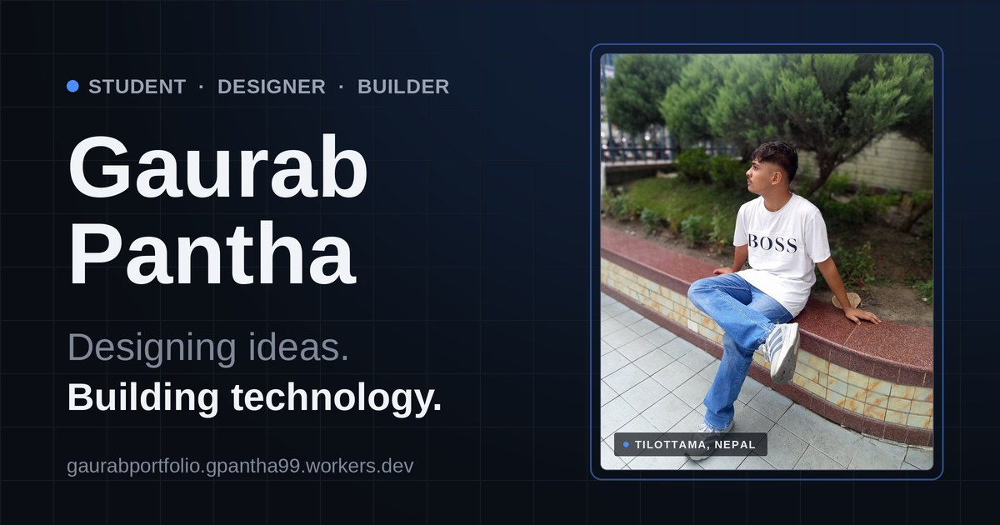

<div align="center">

# Gaurab Pantha — Portfolio

**Designing ideas. Building technology.**

A fast, accessible personal portfolio for a Grade 10 student, graphic designer and builder — robotics, browser extensions, Hack Club projects and SSIRC activities.

[**Live site →**](https://gaurabportfolio.gpantha99.workers.dev) &nbsp;·&nbsp; [Projects](https://gaurabportfolio.gpantha99.workers.dev/projects.html) &nbsp;·&nbsp; [About](https://gaurabportfolio.gpantha99.workers.dev/about.html) &nbsp;·&nbsp; [Contact](https://gaurabportfolio.gpantha99.workers.dev/contact.html)




</div>

---

## About

This is my personal portfolio website. It shows who I am, what I have built, and the workshops and events I take part in through **SSIRC** (Shanti Science ICT & Robotics Club) and **Hack Club**.

It is a plain static site — **HTML, CSS and vanilla JavaScript**. There is no framework, no build tool and no dependencies, so it loads fast and is easy to edit.

## Features

- **Dark, modern design** with a soft glow, grid background and smooth scroll-reveal animations
- **Filterable projects** — filter by Extensions, Robotics or Hack Club, with live counts. Link straight to a filter, e.g. `projects.html#robotics`
- **Gallery viewer** with previous/next buttons, arrow keys and swipe on phones
- **Contact page** with a message form that opens the visitor's email app, plus social links
- **Fully responsive** — tested from 320px phones up to large desktops
- **Accessible** — skip link, keyboard navigation, visible focus states, labelled controls and `prefers-reduced-motion` support
- **SEO and sharing ready** — meta tags, Open Graph / Twitter card image, structured data, `sitemap.xml` and `robots.txt`
- **Custom favicon and 404 page**

## Pages

| Page | File | What it shows |
| --- | --- | --- |
| Home | `index.html` | Intro, what I do, selected work, SSIRC, contact |
| About | `about.html` | Story, skills, learning journey, SSIRC role, Hack Club |
| Projects | `projects.html` | Filterable projects, events and photo gallery |
| Contact | `contact.html` | Message form and links |
| 404 | `404.html` | Friendly "page not found" |

## Project structure

```
gaurab-portfolio/
├── index.html  about.html  projects.html  contact.html  404.html
├── css/
│   ├── style.css          # design tokens, components, polish
│   └── responsive.css     # breakpoints (1024 / 768 / 425 / 375 / 320)
├── js/
│   ├── config.js          # ← your contact details (edit this)
│   ├── projects.js        # ← your project list + filtering (edit this)
│   ├── main.js            # nav, scroll effects, reveal, gallery viewer
│   └── contact.js         # contact page logic
├── assets/
│   ├── images/            # profile, projects, events, gallery, og-card.jpg
│   └── icons/             # github, instagram, facebook, linkedin, mail
├── favicon.svg  favicon.ico  favicon-192.png  favicon-512.png  apple-touch-icon.png
├── sitemap.xml  robots.txt  _headers
└── README.md
```

## Run it locally

No install needed. From the project folder, start any static server:

```bash
# Python (already on most computers)
python3 -m http.server 8000

# or Node
npx serve
```

Then open **http://localhost:8000**.

> Opening `index.html` by double-click also works for most pages, but a local server matches the live site more closely.

## Deploy

The site is hosted on **Cloudflare** and deploys straight from this GitHub repository.

1. Edit or upload files on GitHub.
2. Click **Commit changes**.
3. Cloudflare rebuilds and publishes within a minute or two.

There is no build command. The output directory is the project root.

## How to update the site

### 1. Contact details — `js/config.js`

```js
window.SITE = {
  email: "gpantha99@gmail.com",
  github: "https://github.com/gaurab-pantha",
  instagram: "https://www.instagram.com/myselfgaurav99/",
  facebook: "https://www.facebook.com/myselfgaurav99",
  linkedin: ""   // leave "" to keep it hidden
};
```

Anything left as `""` stays hidden. These values feed the contact page, the footer icons and the contact form. The links on the home page hero and contact section are written in `index.html`, so update them there too if they change.

### 2. Add or edit a project — `js/projects.js`

Add an object to the `PROJECTS` array and put a 4:3 image (about 1200×900) in `assets/images/projects/`:

```js
{
  slug: "my-new-project",
  name: "My New Project",
  category: "Robotics",        // label shown on the card
  filter: "robotics",          // extensions | robotics | hackclub
  desc: "One or two sentences about what it does.",
  tags: ["ESP32", "Bluetooth"],
  image: "assets/images/projects/my-new-project.jpg",
  link: "https://github.com/gaurab-pantha/my-new-project"
}
```

While `link` is `""`, the card shows **"Link coming soon"** instead of a dead link. To add a brand-new filter button, add it in `projects.html` and add its value to the `filters` list in `js/projects.js`.

The three project cards on the home page are written by hand in `index.html`. Replace
`<span class="project-link is-soon">Link coming soon</span>` with:

```html
<a class="project-link" href="https://..." target="_blank" rel="noopener">View project <span class="arrow" aria-hidden="true">&rarr;</span></a>
```

### 3. Event dates — `projects.html`

Under an event's description, add:

```html
<span class="event-date">12 March 2026</span>
```

### 4. Gallery photos

Add a `<figure class="gallery-item">` block in `projects.html` using the same pattern as the others. The viewer picks it up automatically.

### 5. Profile photo and share image

- Profile photo: `assets/images/profile/gaurab-hero.jpg` (4:5 ratio, 864×1080 works well)
- Share preview (WhatsApp, Facebook, etc.): `assets/images/og-card.jpg` at 1200×630
- Browsers and social apps cache images, so **use a new file name** when you replace a photo, then update the references

<details>
<summary><strong>Add an Achievements section to the About page</strong></summary>

The section is hidden until there is something real to show. Paste this back into `about.html` where the `ACHIEVEMENTS` comment is, and edit the text:

```html
<!-- ACHIEVEMENTS -->
  <section class="section">
    <div class="container">
      <div class="section-head" data-reveal>
        <div>
          <p class="eyebrow">Achievements</p>
          <h2 class="section-title">Recognition along the way</h2>
        </div>
        <p class="section-meta">Updated as things happen — no placeholders passed off as real.</p>
      </div>

      <div class="achieve-grid" data-reveal>
        <div class="achieve-card">
          <p class="achieve-cat">SSIRC Leadership</p>
          <p class="achieve-body">Serving as Marketing, Graphic Design, Media &amp; Documentation, and Administrator Head at SSIRC.</p>
        </div>
        <div class="achieve-card is-empty">
          <p class="achieve-cat">Robotics</p>
          <p class="achieve-body">To be added — competition results and certificates will appear here.</p>
        </div>
        <div class="achieve-card is-empty">
          <p class="achieve-cat">Hack Club</p>
          <p class="achieve-body">To be added — project milestones and recognitions will appear here.</p>
        </div>
      </div>
    </div>
  </section>
```

</details>

## If you change the web address

Replace `https://gaurabportfolio.gpantha99.workers.dev` in:

- all five `.html` files (canonical, Open Graph and structured-data links)
- `sitemap.xml` and `robots.txt`
- `assets/images/og-card.jpg` (the share image shows the address in small text)

## Design notes

| Token | Value |
| --- | --- |
| Background | `#0a0e14` |
| Accent | `#4d8dff` |
| Headings | Space Grotesk |
| Body | Inter |

All colors, spacing and motion are CSS variables at the top of `css/style.css`, so the whole look can be changed from one place.

## Browser support

Current versions of Chrome, Edge, Firefox and Safari, on desktop and mobile.

## Author

**Gaurab Pantha** — Grade 10 student, Shree Shanti Namuna Secondary School, Tilottama, Nepal.

- Email: [gpantha99@gmail.com](mailto:gpantha99@gmail.com)
- GitHub: [@gaurab-pantha](https://github.com/gaurab-pantha)
- Instagram: [@myselfgaurav99](https://www.instagram.com/myselfgaurav99/)
- Facebook: [myselfgaurav99](https://www.facebook.com/myselfgaurav99)

## License

© 2026 Gaurab Pantha. All rights reserved. The code is shared so you can read and learn from it; please do not copy the design, text or photos as your own portfolio without permission.
